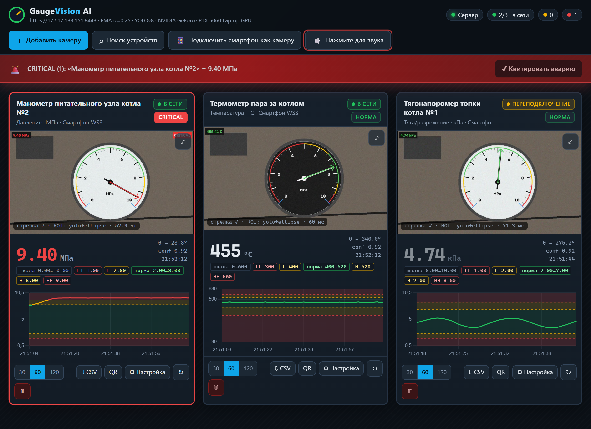
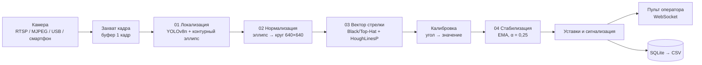
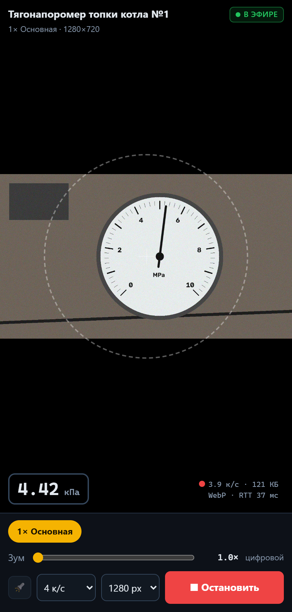
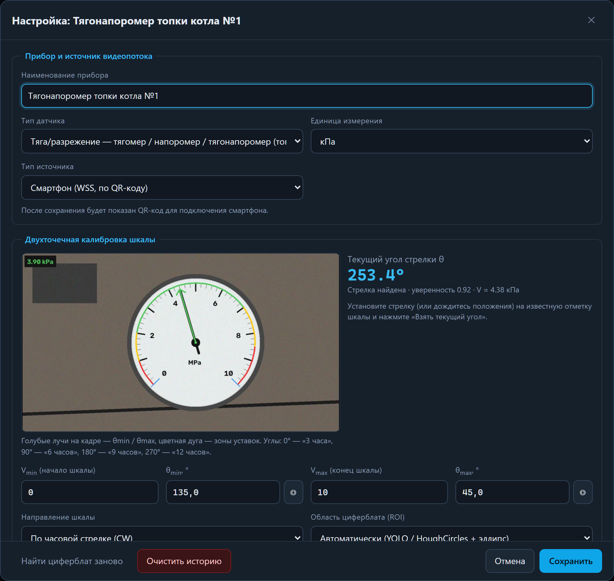

# GaugeVision AI

**Компьютерное зрение для аналогового контура ТЭЦ.** Сервис оцифровывает показания стрелочных приборов КИПиА с помощью обычных камер: без врезки в трубопроводы, без прокладки кабельных трасс и без останова оборудования.


> Трек №3 «Умное производство: ИИ-аналитика видеоданных для повышения эффективности»



**6 классов приборов · 17 единиц измерения · 0,38 % максимальная ошибка шкалы на стенде · 7,2 мс инференс YOLOv8n на GPU**

---

## Содержание

- [Проблема](#проблема)
- [Возможности](#возможности)
- [Как это работает](#как-это-работает)
- [Метрики](#метрики)
- [Быстрый старт](#быстрый-старт)
- [Подключение камер](#подключение-камер)
- [Калибровка и уставки](#калибровка-и-уставки)
- [Конфигурация](#конфигурация)
- [API](#api)
- [Экспорт данных](#экспорт-данных)
- [Структура проекта](#структура-проекта)
- [Ограничения](#ограничения)
- [Масштабирование](#масштабирование)
- [Roadmap](#roadmap)
- [Презентация](#презентация)
- [Лицензия](#лицензия)

## Проблема

На ТЭЦ и в котельных значительная часть приборов (по оценке команды, до 60 %) остаётся вне АСУ ТП. Тягомеры, манометры и уровнемеры работают как локальные индикаторы и не передают сигнал на щит управления.

- **Замена на смарт-датчик дорогая.** Нужны искробезопасные барьеры, кабельные трассы, проект и плановый останов котлоагрегата.
- **Обход раз в смену.** Отклонение между обходами остаётся незамеченным, а диспетчер получает запись из журнала с задержкой.

Цепочка «прибор → обходчик и журнал → диспетчер» заменяется на «прибор → камера → пульт оператора». Камера считывает показания снаружи технологического контура.

## Возможности

- **6 классов приборов ТЭЦ:** давление, температура, тяга и разрежение, уровень, электрические щитовые приборы, расход.
- **Любой источник видео:** IP-камеры RTSP и NVR, ONVIF, HTTP/MJPEG, USB-камеры, смартфон по QR-коду без установки приложения.
- **Автопоиск устройств:** ONVIF WS-Discovery и сканирование подсети /24.
- **Двухточечная калибровка шкалы** по текущему углу стрелки, направление CW/CCW.
- **Пятизонная модель уставок** LL / L / НОРМА / H / HH по ISA-18.2 / ГОСТ Р МЭК 62682.
- **Сигнализация:** цветовая индикация, звуковая сирена и квитирование аварии на всех открытых пультах.
- **Живые тренды** на 30 / 60 / 120 точек и MJPEG-превью с оверлеем распознавания.
- **Архив и экспорт:** SQLite, выгрузка в CSV с метками времени ISO 8601 UTC.
- **Устойчивость к сбоям:** переподключение с экспоненциальной задержкой, статусы связи, удержание последнего достоверного значения.
- **Полностью локальный контур:** HTTPS / WSS, самоподписанный сертификат генерируется автоматически, исходящих запросов в интернет нет.

## Как это работает



1. **Локализация.** Детектор YOLOv8n находит корпус прибора, затем граница циферблата уточняется по контуру эллипса. Если весов модели нет, работает резервный конвейер OpenCV: CLAHE + HoughCircles + контур.
2. **Нормализация.** Эллипс циферблата аффинно выпрямляется в круг 640 × 640 px. На стенде проверены наклоны камеры до ≈41°.
3. **Вектор стрелки.** Морфология Black-Hat / Top-Hat (тёмные и светлые стрелки), HoughLinesP и радиальный момент. Угол стрелки: θ = atan2(Δy, Δx).
4. **Перевод в значение.** Линейная двухточечная калибровка:
   `V = Vmin + ((θ - θmin) mod 360) / span · (Vmax - Vmin)`.
5. **Стабилизация.** EMA-фильтр подавляет вибрацию: `V̂ₜ = 0,25 · Vₜ + 0,75 · V̂ₜ₋₁`. Кадр с уверенностью распознавания стрелки ниже 0,25 считается недостоверным и не записывается: в этом случае удерживается последнее значение.

Модель `models/gauge_yolov8.pt` - YOLOv8n с двумя классами: `Gauge` и `Needle`. Конвейер использует бокс `Gauge`, а стрелку находит геометрическими методами OpenCV.

## Метрики

| Показатель | Значение | Условия |
|---|---|---|
| mAP₅₀ детектора | 90,1 % | YOLOv8n, 25 эпох, валидация обучения |
| Recall `Gauge` / Precision `Needle` | 1,00 / 1,00 | валидация обучения |
| Инференс YOLOv8n | 7,2 мс/кадр | RTX 5060 Laptop, FP16, кадр 1280×720 |
| Инференс YOLOv8n на CPU | 29 мс/кадр | FP32 |
| Полный конвейер | 30-100 мс/кадр | локализация, нормализация, стрелка, EMA |
| Максимальная ошибка шкалы | 0,38 % | 28 сцен стенда, средняя ошибка 0,11 % |
| Поток со смартфона | 3-4 к/с | WebP, 1280 px |
| Ответ сервера | 3-37 мс | демонстрация со смартфоном |

Стенд включает синтетические приборы с тёмными, светлыми и красными стрелками, наклон камеры ≈41°, посторонние объекты в кадре и шум. Проверки: e2e-набор сервера (34 проверки) и браузерный тест (18 проверок).

## Быстрый старт

### Требования

- Windows 10/11 или Linux
- Python **3.12**
- NVIDIA GPU с CUDA (рекомендуется). Без GPU сервис работает на CPU.
- Камера или смартфон в той же локальной сети

### Установка

```powershell
git clone https://github.com/EGRNEGR/GaugeVisionAI.git
cd GaugeVisionAI
py -3.12 -m venv .venv

# PyTorch ставится ПЕРВЫМ, иначе pip установит CPU-сборку
.\.venv\Scripts\pip install torch torchvision --index-url https://download.pytorch.org/whl/cu130
# Без NVIDIA GPU:
# .\.venv\Scripts\pip install torch torchvision

.\.venv\Scripts\pip install -r requirements.txt
```

Видеокарты RTX 50xx (Blackwell, sm_120) поддерживаются стабильными сборками PyTorch с CUDA 12.8+. Nightly-сборки не нужны.

Проверка GPU:

```powershell
.\.venv\Scripts\python -c "import torch; print(torch.__version__, torch.version.cuda, torch.cuda.is_available(), torch.cuda.get_device_name(0))"
```

### Запуск

```powershell
.\.venv\Scripts\python run.py
```

При запуске `run.py`:

1. создаёт самоподписанный сертификат в `certs/` (RSA-2048, 365 дней, SAN: `localhost`, `127.0.0.1` и LAN IP) и перевыпускает его при смене IP хоста;
2. определяет LAN IP, пропуская адреса VPN/TUN-адаптеров (198.18.0.0/15) и link-local;
3. печатает ссылки и SHA-256 отпечаток сертификата;
4. запускает Uvicorn **только по HTTPS** на порту 8443.

Пульт оператора открывается по адресам `https://localhost:8443` и `https://<LAN_IP>:8443`.

Параметры командной строки:

| Флаг | Назначение |
|---|---|
| `--host` | адрес привязки, по умолчанию `0.0.0.0` |
| `--port` | порт HTTPS, по умолчанию `8443` |
| `--lan-ip 192.168.1.10` | задать LAN IP вручную, если автоопределение выбрало не тот интерфейс |
| `--log-level` | `debug`, `info`, `warning` или `error` |

> **Сертификат.** На каждом новом устройстве предупреждение браузера нужно принять один раз. В Chrome: «Дополнительно» → «Перейти на сайт», в Safari: «Подробнее» → «посетить веб-сайт». Без HTTPS браузер не даст доступ к камере смартфона.
>
> **Брандмауэр.** Если пульт не открывается со смартфона, разрешите входящие подключения на порт 8443 в брандмауэре Windows.

## Подключение камер

| Источник | Как добавить |
|---|---|
| IP-камера RTSP / NVR | «Добавить камеру» → RTSP, `rtsp://user:pass@IP:554/...` |
| HTTP/MJPEG (IP Webcam, DroidCam, ESP32-CAM) | «Добавить камеру» → HTTP/MJPEG, например `http://IP:8080/video` |
| USB-камера сервера | «Добавить камеру» → Локальная, индекс `0` |
| Автопоиск | «Поиск устройств»: ONVIF WS-Discovery + скан подсети /24 по портам 554, 80, 8080, 4747, 8554 |
| Смартфон | «Подключить смартфон как камеру» → QR-код → браузер телефона → «Начать трансляцию» |

### Смартфон как камера



**QR-код → браузер → видеопоток.** Приложение устанавливать не нужно. Телефон и сервер должны быть в одной локальной сети.

- Кадры передаются по WSS в формате WebP или JPEG с токеном сессии.
- В клиенте доступны выбор объектива, зум и фонарь (Torch API), если их поддерживают устройство и браузер.
- Если кадров нет дольше 6 с, камера получает статус «офлайн».

При обрыве потока сервер повторяет подключение с интервалами 1 → 2 → 4 → 8 → 15 с. После 8 неудачных попыток подряд камера переходит в статус «офлайн».

<br clear="right">

## Калибровка и уставки



Калибровка открывается кнопкой «⚙ Настройка» на карточке прибора.

1. Выберите тип прибора и единицу измерения.
2. Задайте две точки шкалы: Vmin / θmin и Vmax / θmax. Кнопка ◎ подставляет текущий угол стрелки.
3. Укажите направление шкалы: по часовой стрелке (CW) или против (CCW).

Углы задаются в координатах кадра: 0° соответствует «3 часам», 90° - «6 часам», 180° - «9 часам», 270° - «12 часам». Типовая шкала на 270°: θmin = 135°, θmax = 45°.

Уставки задаются в порядке LL ≤ L ≤ H ≤ HH и делят шкалу на пять зон:

| Зона | Условие | Статус |
|---|---|---|
| LL / HH | V ≤ LL или V ≥ HH | авария (`alert`) |
| L / H | V ≤ L или V ≥ H | предупреждение (`warning`) |
| НОРМА | L < V < H | норма (`normal`) |

### Типы приборов и единицы измерения

| Тип | Приборы | Единицы |
|---|---|---|
| `pressure` | манометр, вакуумметр, мановакуумметр | МПа, бар, кгс/см², кПа |
| `temperature` | манометрический и биметаллический термометр | °C |
| `draft` | тягомер, напоромер, тягонапоромер | кПа, Па, кгс/м² |
| `level` | стрелочный уровнемер | %, мм, м |
| `electrical` | щитовой амперметр, вольтметр, ваттметр | А, кА, В, кВ, МВт |
| `flow` | дифманометр-расходомер | т/ч, м³/ч |

## Конфигурация

Все параметры имеют значения по умолчанию, обязательных переменных окружения нет.

| Переменная | По умолчанию | Назначение |
|---|---|---|
| `GAUGEVISION_DB` | `data/gaugevision.db` | путь к базе SQLite |
| `GAUGEVISION_YOLO` | `models/gauge_yolov8.pt` | веса детектора |
| `GAUGEVISION_DEVICE` | `auto` | `auto`, `cuda:0` или `cpu`. На GPU используется FP16 |
| `GAUGEVISION_KEEP_DAYS` | `90` | срок хранения истории, сутки |
| `GAUGEVISION_HOST` | `0.0.0.0` | адрес привязки |
| `GAUGEVISION_PORT` | `8443` | порт HTTPS |
| `GAUGEVISION_LAN_IP` | автоопределение | LAN IP для ссылок и QR-кода |

Основные параметры конвейера находятся в `app/config.py`:

| Параметр | Значение | Смысл |
|---|---|---|
| `EMA_ALPHA` | 0,25 | коэффициент сглаживания |
| `YOLO_CONF` / `YOLO_IMGSZ` | 0,35 / 640 | порог и размер входа детектора |
| `MIN_NEEDLE_CONFIDENCE` | 0,25 | ниже - отсчёт недостоверен |
| `DIAL_SIZE` | 640 px | размер нормализованного циферблата |
| `PROCESS_FPS` | 3 | частота обработки каждой камеры |
| `DB_WRITE_INTERVAL` | 1 с | минимальный интервал записи в БД |
| `REDETECT_EVERY_N_FRAMES` | 15 | период повторной локализации циферблата |
| `MAX_PROCESS_WIDTH` | 1280 px | более широкие кадры масштабируются |

Если файла весов или пакета `ultralytics` нет, сервис автоматически переходит на резервный конвейер OpenCV.

## API

Интерактивная документация OpenAPI: `https://localhost:8443/api/docs`.

| Метод | Маршрут | Назначение |
|---|---|---|
| GET | `/` | пульт оператора |
| GET | `/capture?cam_id=&token=` | страница захвата для смартфона |
| GET | `/api/meta` | справочники, LAN IP, ссылки, версия |
| GET | `/api/health` | проверка состояния |
| GET | `/api/cert.pem` | сертификат для установки на телефон |
| GET, POST | `/api/cameras` | список камер, добавление |
| GET, PATCH, DELETE | `/api/cameras/{id}` | чтение, изменение, удаление |
| POST | `/api/cameras/{id}/restart` | перезапуск потока |
| POST | `/api/cameras/{id}/redetect` | повторный поиск циферблата |
| GET | `/api/cameras/{id}/frame.jpg` | последний кадр с оверлеем |
| GET | `/api/cameras/{id}/mjpeg` | MJPEG-поток с оверлеем |
| GET, DELETE | `/api/cameras/{id}/history` | история показаний |
| GET | `/api/cameras/{id}/export.csv` | экспорт в CSV |
| POST | `/api/phone/session` | токен и QR-код (SVG) для смартфона |
| GET | `/api/discover` | поиск камер: ONVIF и скан подсети |
| POST | `/api/alarms/ack` | квитирование аварий на всех пультах |

WebSocket:

- `/ws/dashboard` - телеметрия пульта: сообщения `status`, `reading`, `camera_added`, `camera_updated`, `camera_deleted`;
- `/ws/phone/{cam_id}?token=` - бинарные кадры JPEG/WebP со смартфона.

## Экспорт данных

CSV формируется в кодировке UTF-8 с BOM (корректно открывается в Excel). Разделитель - `;`.

```csv
timestamp_iso8601;value_МПа;raw_angle_deg;status_level
2026-10-20T18:52:12.431+00:00;9.4012;28.84;alert
```

Значение записывается с 4 знаками после запятой, угол - с 2. Имя файла: `<название прибора>_<метка времени>.csv`.

## Структура проекта

```
GaugeVisionAI/
├── run.py              # точка входа: сертификат, LAN IP, запуск Uvicorn
├── requirements.txt
├── app/
│   ├── config.py       # константы, типы приборов и единицы
│   ├── main.py         # FastAPI: REST, WebSocket, оркестрация камер
│   ├── vision.py       # CV-конвейер: локализация, нормализация, стрелка, EMA
│   ├── streamer.py     # захват RTSP / MJPEG / USB с переподключением
│   ├── discovery.py    # ONVIF WS-Discovery и скан подсети
│   ├── db.py           # aiosqlite, история, экспорт CSV
│   └── cert_gen.py     # самоподписанный X.509 с SAN
├── static/
│   ├── index.html      # пульт оператора
│   ├── capture.html    # клиент захвата для смартфона
│   ├── css/
│   └── js/             # app.js, capture.js, Chart.js (локально, без CDN)
├── models/
│   └── gauge_yolov8.pt # YOLOv8n: классы Gauge, Needle
├── docs/images/        # скриншоты для README
├── GuageVision AI.pdf  # презентация
└── LICENSE
```

Каталоги `certs/` и `data/` создаются при первом запуске.

## Ограничения

| Условия среды | Риск | Реализованный ответ | Статус |
|---|---|---|---|
| Блики, тени, копоть | ошибки выделения шкалы и стрелки | CLAHE, Black/Top-Hat, выбор маски по уверенности, фонарь Torch API | реализовано |
| Вибрация | дрожание показаний | EMA с α = 0,25, гистерезис области циферблата (ROI) | реализовано |
| Съёмка под углом | искажение геометрии | эллипс + аффинная нормализация (стенд до ≈41°); полная гомография в плане | частично |
| Загрязнение стекла | падение достоверности | порог уверенности 0,25, удержание последнего значения; автоалерт в плане | частично |
| Обрыв сети или камеры | потеря телеметрии | переподключение 1-15 с, статусы связи, сохранение достоверного значения | реализовано |

В полевых условиях пока не проверены нелинейные шкалы, многострелочные приборы и длительная работа на станции. Испытания проводились на стенде и синтетических сценах.

## Масштабирование

| Конфигурация | Оборудование | Пропускная способность |
|---|---|---|
| **25 камер** (стенд команды) | RTX 5060 Laptop 8 GB, 16 GB RAM | 100 к/с при 4 к/с на камеру, загрузка GPU 72 % |
| **50 камер** (расчёт) | RTX 4070 Ti Super 16 GB, 32 GB RAM, CPU 8 ядер, NVDEC | 200 к/с, узел ≈230-260 тыс. ₽ |
| **100 камер** (расчёт) | RTX 4090 24 GB или 2 × RTX 4070 Ti Super, 64 GB ECC, RAID-1, 2 × 10GbE, 2U | 400 к/с, узел ≈580-680 тыс. ₽ |

**Экономика точки контроля (оценка команды):**

| Вариант | Стоимость на прибор |
|---|---|
| Классическая замена на смарт-датчик | 300 000 ₽ |
| GaugeVision AI + камера «Рубитек» (RTSP / ONVIF, PoE) | 33 000 ₽ |

Затраты на одну точку ниже на 89 %. Расчётная экономия на 100 приборах составляет 26,7 млн ₽, ориентировочная окупаемость на один турбогенератор - менее 2 месяцев. Цифры требуют подтверждения на пилоте.

## Roadmap

- [x] **01 MVP.** 6 классов приборов, YOLOv8n на CUDA, смартфон по QR-коду, уставки, сирена и экспорт в CSV.
- [ ] **02 Связь со SCADA.** Modbus TCP и OPC UA, полевой пилот на станции, полная гомография, нелинейные шкалы и многоточечная калибровка.
- [ ] **03 Масштаб цеха.** PTZ-камеры с пресетами обхода (одна камера на десятки приборов), нательные регистраторы обходчиков.

## Презентация

Полная презентация проекта: [GuageVision AI.pdf](GuageVision%20AI.pdf).

## Лицензия

© 2026 EGRNEGR. **Все права защищены.** Код, веса модели и материалы опубликованы только для ознакомления. Использование, запуск, копирование, изменение и распространение без письменного разрешения правообладателя запрещены. Сторонние библиотеки распространяются на условиях своих лицензий. Полный текст: [LICENSE](LICENSE).
