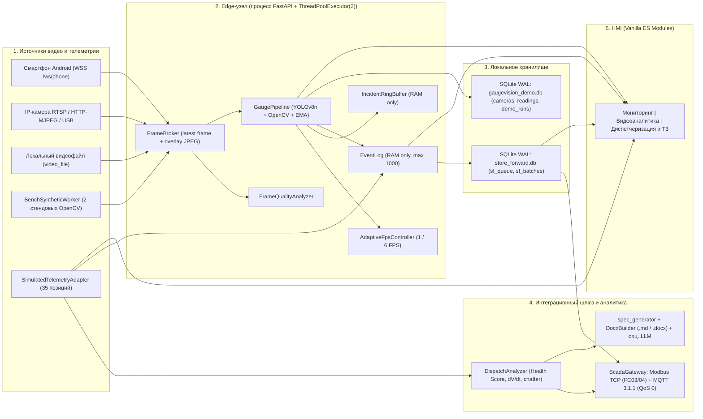

# Архитектурный обзор (Architecture Review) — GaugeVision AI

## 1. Восстановленная фактическая архитектура и потоки данных

Анализ выполнен непосредственно по исходному коду (`app/*.py`, `static/js/console/*.js`) без опоры на существующие диаграммы и описания.

---

## 2. Карта фактической связанности компонентов

| Компонент | Фактический статус связи | Наблюдения аудита |
|---|---|---|
| `EdgeStreamManager` + `FrameBroker` + `GaugePipeline` | **Реально связаны** | Живые кадры WSS, `video_file` и 2 стендовых потока реально проходят через `FrameBroker` -> `GaugePipeline` (YOLOv8n + OpenCV) -> `overlay`. |
| `AdaptiveFpsController` -> `_process_loop` / `_bench_process_loop` | **Реально связаны** | `adaptive.interval` реально управляет сном цикла обработки (подтверждено снижением CPU на 70,8%). |
| `IncidentRingBuffer` -> `spec_generator` | **Частично связаны** | `latest_keyframe()` подтягивается в `_collect_snapshots_by_inst()` для 2 стендовых каналов, но архивы клипов (`_archives`) не экспонируются через API и теряются при рестарте. |
| `StoreAndForwardBuffer` -> `ScadaGateway` | **Дефектная связь (`DEF-01`, `DEF-06`)** | При ручном `outage_active=True` буферизация и досылка пачками работают на реальном SQLite WAL. При реальном падении MQTT-брокера `deliver_batch()` ошибочно возвращает `True` и данные теряются. `frame_blob` сохраняется, но не передаётся при досылке. |
| `SimulatedTelemetryAdapter` -> `DispatchAnalyzer` | **Смешанная граница (`DEF-08`)** | 35 позиций симуляции смешиваются с 1 живой камерой в одном `DispatchAnalyzer`, при этом `_BENCH_DIAGNOSTIC_PROFILES` внутри production-модуля искусственно накручивает `chatter_pct` и `overload_min_base`. |
| `db.readings` -> `spec_generator` | **Разорванная связь (`DEF-03`)** | Историческая БД `readings` и `events` НЕ используются при формировании раздела 2 («Протокол за период»). |
| `/api/events/stream` (SSE) -> HMI | **Изолирован** | SSE-маршрут реально работает и шлёт события, но фронтенд использует исключительно WebSocket `/ws/dashboard` (SSE доступен для внешних потребителей). |
| `FrameQualityAnalyzer.record_drop()` | **Формальный / мёртвый код (`DEF-11`)** | Ни один воркер не вызывает `record_drop()`; метрика потерь пакетов работает только при `injected_fault="packet_loss"`. |

---

## 3. Архитектурные риски и единые точки отказа (SPOF)

1. **Единый процесс (Monolithic Edge + Central HMI):** Захват видео, инференс YOLO, Store-and-Forward, SCADA-шлюз, аналитика и веб-сервер HMI работают в одном Python-процессе. Падение процесса (OOM/segfault в C++/OpenCV) останавливает одновременно и Edge-сбор, и операторский контур.
2. **Общий пул `ThreadPoolExecutor(max_workers=2)` + глобальный `_YOLO_INFER_LOCK`:** Все каналы делят 2 потока зрения и сериализуются на одном lock при вызове `model.predict()`. При 8+ каналах на CPU с частыми перелокализациями (`REDETECT_EVERY_N_FRAMES=15`) задержка хвоста будет расти пропорционально числу камер.
3. **Уязвимость к потере памяти процесса (In-Memory State):** `EventLog` (история тревог и стоп-кадров), `IncidentRingBuffer._archives`, `DispatchAnalyzer._series` / `_overload_sec` / `_auto_spec_triggers` и токены смартфонов хранятся только в RAM и исчезают при перезапуске.
4. **Неограниченный рост `sf_queue` при длительном обрыве (`DEF-06`):** Отсутствие квоты на `pending`-строки и бинарные `frame_blob` создаёт риск переполнения диска Edge-устройства.
5. **Отсутствие границы доверия (Trust Boundary):** Все API, включая `POST /api/architecture/outage`, `/degrade`, `DELETE /api/cameras/{id}` и `GET /api/discover`, открыты без аутентификации на `0.0.0.0:8443`.

---

## 4. Сравнение с baseline (`dd25bde`)

По данным `git diff --stat dd25bde`:
- Модуль `app/vision.py` изменён ограниченно (`+48/-22` строк — в основном настройки `YOLO_CONFIG_DIR`, `lower_enabled`, `max_overshoot`), ядро алгоритма локализации и расчёта угла сохранено, однако в `draw_overlay()` присутствует дефект затенения переменной `level` (`DEF-02`).
- Добавлены 6 новых модулей бэкенда (`stream_manager.py`, `store_forward.py`, `scada_gateway.py`, `dispatch_analyzer.py`, `spec_generator.py`, `docx_builder.py`) и 2 модуля фронтенда (`architecture.js`, `dispatch.js`) без поломки существующего контракта 36 приборов и WSS-протокола смартфона.
- Замечены нарушения границ слоёв: демонстрационные профили и фиктивные штампы (`_BENCH_DIAGNOSTIC_PROFILES`, `CONF=0.94`, `injected_fault` overrides) попали напрямую в производственные модули.
