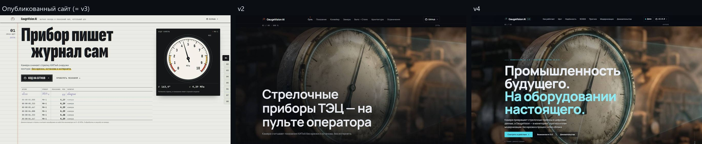
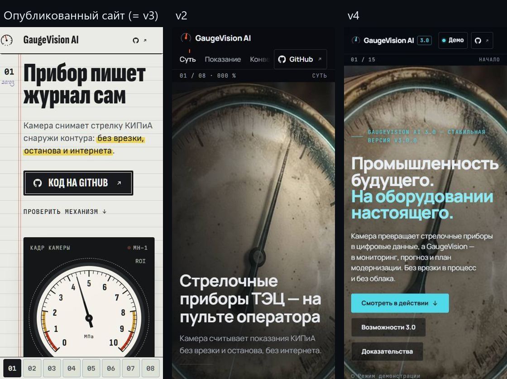

# Сравнение версий сайта: до и после (v2, v3 / опубликованная и v4)

Дата: 27.11.2026. Сравниваются три состояния сайта GaugeVision AI: действующий сайт на Tilda (`https://gaugevs.tilda.ws/`, собранный из локальной версии v3 «Журнал обходчика»), локальная тёмная версия v2 («Пульт оператора», ветка `GaugeVision-2.0`, коммит `94e646e`) и новая версия v4 (`site/v4` ветки `redesign/website-v4`), созданная под релиз `v3.0.0` (коммит `0273436`).

Исходные измерения получены одним скриптом `evidence/scripts/audit.mjs` в Microsoft Edge (Playwright, без расширений). Сырые отчёты лежат в `evidence/audit/*_audit.json`, подробный разбор старых версий — в `WEBSITE_AUDIT.md`.

## 1. Сводные метрики (1920×1080)

Таблица повторяет сводные измерения раздела 1 `WEBSITE_AUDIT.md`:

| Показатель (1920×1080) | Опубликованный сайт (= v3) | v2 локально | v3 локально | v4 локально |
|---|---|---|---|---|
| Время до `load`, мс | 4785 | 991 | 1794 | 373 |
| Запросов | 30 | 47 | 43 | 66 |
| Объём, МБ | 11,7 | 8,9 | 12,0 | 10,8 |
| Доменов | 7 | 1 | 1 | 1 |
| Высота страницы, px | 19 341 | 16 236 | 19 271 | 30 673 |
| Узлов DOM | 1828 | 1130 | 1729 | 2516 |
| Видимого текста, символов | 9207 | 6520 | 9148 | 19 285 |
| Средних точек (U+00B7) в тексте | 8 | 12 | 4 | 0 |
| Ошибок консоли | 0 | 0 | 0 | 0 |
| Горизонтальное переполнение | нет | нет | нет | нет |

Дополнительно по мобильному разрешению 390×844 (`evidence/audit/*_audit.json`):

| Показатель (390×844) | Опубликованный сайт (= v3) | v2 локально | v3 локально | v4 локально |
|---|---|---|---|---|
| Время до `load`, мс | 5200 | 717 | 993 | 342 |
| Запросов | 29 | 47 | 43 | 66 |
| Объём, МБ | 5,86 | 4,99 | 6,15 | 6,40 |
| Доменов | 6 | 1 | 1 | 1 |
| Высота страницы, px | 19 549 | 17 608 | 19 479 | 34 649 |
| Горизонтальное переполнение | нет | нет | нет | нет |

Время загрузки опубликованного сайта включает внешнюю сеть (Tilda CDN, jsDelivr, Google Fonts и счётчики), поэтому напрямую сопоставимы только локальные прогоны v2, v3 и v4. По объёму на десктопе v4 легче опубликованного сайта и v3 (10,8 МБ против 11,7–12,0 МБ), несмотря на 15 секций, 19 локальных изображений и 12-шаговый режим демонстрации: основную разницу даёт ролик первого экрана (8,3 МБ вместо 11,6 МБ в v3; на 768 и 390 px грузится мобильный файл 4,3 МБ).

## 2. Визуальное сравнение первых экранов

### Десктоп 1920×1080

### Смартфон 390×844

Полные снимки старых и новой версий по всем разрешениям находятся в `evidence/screenshots/before/{published,v2,v3}/` и `evidence/screenshots/after/`.

На сравнении первых экранов видны ключевые изменения композиции:
- **Опубликованный сайт (= v3)** строится на светлой бумажной палитре «Журнала обходчика» с узким акцидентным шрифтом Sofia Sans Extra Condensed. На мониторе метафора считывается быстро, но при показе на проекторе светлый фон `#EEF0EE` и тонкие линии линовки выцветают. На экране 1920×1080 видно, что продукт подан только как «журнал обходчика» версии 2.0.
- **v2** задала тёмный фон пульта и ролик с отъездом камеры от манометра, но первый экран содержал только заголовок и одну короткую строку без навигационных призывов к действию, оранжевый цвет смешивался с цветом тревоги, а на 390×844 ссылки навигации обрезались у правого края шапки.
- **v4** сохраняет тёмную палитру и ролик v2, усиливает контраст текста над фоном ролика (4,8–6,0 по 95-му процентилю пикселей подложки, замер `herochk.mjs`), вводит слоган 3.0 с циановым акцентом, добавляет три ясных перехода («Смотреть в действии», «Возможности 3.0», «Доказательства») и быстрый вход в режим демонстрации в шапке и на первом экране. На 390×844 шапка перестроена без обрезки пунктов: бренд с меткой `3.0`, кнопка «Демо» и ссылка на тег `v3.0.0`.

## 3. Что сохранено из предыдущих версий и почему

| Элемент | Откуда взят | Почему сохранён в v4 |
|---|---|---|
| Модульный каркас без фреймворка (`GV`, `util`, `motion`, `kit`, `mount/destroy`, `content.js`) | v2 | Обеспечивает единый цикл `requestAnimationFrame`, строгую очистку обработчиков, минимальное время исполнения без сборщиков и прямую совместимость со схемой переноса в Vibe-блоки Tilda (`tilda/build.mjs`). |
| Тёмная промышленная палитра поверхностей и пара шрифтов Manrope + JetBrains Mono | v2 | Тёмная сцена диспетчерской стабильно читается на проекторе 16:9 при засветке зала; `tabular-nums` в JetBrains Mono исключает дрожание живых счётчиков и таблиц. |
| Ролик с отъездом камеры от манометра (`scroll-video`) с мобильной версией файла | v2 | Наглядно показывает съёмку стрелки снаружи без вмешательства в трубопровод; экономит 4 МБ на экранах ≤ 768 px. В v4 к ролику добавлена честная подпись «Ролик — иллюстративная генерация, не съёмка объекта». |
| Панель автора Tweaks (`?tweaks`) | v2 | Позволяет быстро переключать гарнитуру, масштаб и глубину фона при очном просмотре без правки кода и без отображения панели обычному посетителю. |
| Открытый раздел ограничений и честный инженерный тон | v3 | Отделяет инженерный прототип от рекламного лендинга; в v4 расширен до матрицы 5 уровней готовности и 6 ограничений со ссылками на отчёты приёмки `v3.0.0`. |
| Идея «было — стало» и живого прибора | v3 | Перенесена в формат, подходящий тёмной теме: интерактивная шторка «Сегодня / С GaugeVision» в секции «Задача» и векторный прибор-герой `PI-102` в 8-этапной закреплённой истории. |

## 4. Что изменено и почему

| Направление | Было (v2 / опубликованная v3) | Стало в v4 | Инженерная причина изменения |
|---|---|---|---|
| Акцентный цвет | В v2 — оранжевый `#FF5A1F` на кнопках и элементах интерфейса; в v3 — жёлтый маркер `#EBD45A` и чёрный | Циан `#4FD8E8` для данных, разметки и действий; зелёный `#5ED39B`, жёлтый `#E9B44C`, красный `#F26B5E` — только для статусов нормы, H и HH | По стандарту HMI (ISA-101) оранжевый и красный резервируются под предупреждения и аварии; в v2 оранжевые кнопки визуально спорили с тревожными уставками. |
| Слоган и позиционирование | v2: «Стрелочные приборы ТЭЦ — на пульте оператора»; v3: «Прибор пишет журнал сам» | «Промышленность будущего. На оборудовании настоящего.» | Продукт 3.0 вышел за рамки оцифровки журнала: он охватывает многоприборный щит, SCADA, прогноз и оптимизацию бюджета модернизации. Слоган сразу снимает возражение о врезке и останове. |
| Архитектура страницы | 8 секций (в v2 — с пустым чёрным экраном на кадрах 6–7 между первым экраном и второй секцией; в v3 — растянутая на 4798 px сцена ролика) | 15 секций и подвал: сквозная история `PI-102` (8 этапов) + отдельные интерактивные секции по каждой возможности 3.0, эволюция, экономика, доказательства, готовность | Каждая возможность 3.0 требует собственной проверяемой демонстрации. Пустые прокруточные зоны убраны; закреплённая история переведена на переключение прозрачностью в одной ячейке сетки (CLS снижен с 0,79 до 0,002). |
| Содержание продукта | Только возможности 2.0 (один прибор, угол → МПа, базовый конвейер, общая схема) | Полный контур 3.0: щит (1 / 2 / 4 / 8 / 16 приборов), симуляция Store-and-Forward, SCADA Ignition 8.3.10, диагностика, прогноз с научной валидацией, точный ILP-оптимизатор в браузере, генератор ТЗ | Отражает фактическое состояние релиза `v3.0.0`, включая честные границы применимости: 47,9 % годных при 16 реальных приборах, 4,65 % полноты прогноза и 36,1 % ложных срабатываний, исключённую автокалибровку, статус `NOT READY` для промышленной эксплуатации. |
| Доказательная база и источники | Оценки команды без ссылок («до 60 % приборов ТЭЦ», «−58 % затрат», «26,7 млн ₽ на 100 приборах») | 50 продуктовых заявлений в `PRODUCT_CLAIMS_REGISTER.md` со ссылками `.gv-src` прямо в тексте на файлы неизменяемого тега `v3.0.0` | Любую цифру на странице жюри или инженер проверяют в один клик по первоисточнику. Единственная оставшаяся оценка команды (33 000 ₽ за камеру из v2) явно подписана и редактируется пользователем. |
| Внешние зависимости и автономность | Опубликованный сайт обращается к 7 доменам (Tilda CDN, jsDelivr, Google Fonts, два счётчика Tilda); ролик привязан к коммиту `10d8029` | 1 локальный домен, 0 внешних запросов (подтверждено при блокировке всех внешних URL в `accept.mjs`) | Сайт можно показывать в закрытой сети предприятия или на защите без интернета; шрифты, видео и снимки хранятся в `site/v4/assets/`. |
| Режим презентации | Отсутствовал (приходилось вручную крутить страницу мышью) | Встроенный режим демонстрации (`?showcase=1`, клавиша `D`): 12 воспроизводимых шагов, управление кликером, пульт внизу экрана, плашки типов материала | Гарантирует предсказуемый трёхминутный показ на проекторе 16:9 (1920×1080 и 1280×720) с центрированием живой демонстрации над пультом. |
| Типографика | 8 средних точек (U+00B7) в опубликованной версии, 12 в v2, 4 в v3 | 0 средних точек; автоматический типограф `typo()` в `content.js` для неразрывных пробелов, длинных тире и единиц | Соответствует правилам русской типографики и требованиям к UI-текстам проекта. |

## 5. Осознанные компромиссы версии v4

Переход на v4 имеет измеримые издержки, которые зафиксированы как ограничения:
1. **Высота страницы выросла с 19 341 до 30 673 px на 1920×1080** (и до 34 449 px на 390×844) из-за 15 секций и закреплённой 8-этапной истории. Компенсировано оглавлением в шапке, полосой прогресса и 12-шаговым режимом демонстрации.
2. **Число HTTP-запросов выросло с 30 (опубликованный) и 47 (v2) до 66** из-за модульной структуры без сборщика (23 скрипта, 11 таблиц стилей, 19 локальных шрифтов, 10 изображений при начальной загрузке). На локальном сервере `load` укладывается в 340–404 мс, однако при переносе на внешний хостинг потребуется объединение файлов (для Tilda это делает `tilda/build.mjs`).
3. **Увеличился объём видимого текста (с 9207 до 19 285 символов)**: вырос не за счёт «воды», а за счёт 6 новых продуктовых секций, раскрывающихся блоков научной валидации, реестра доказательств и подробных подписей ограничений рядом с каждой цифрой.
4. **v4 пока не опубликована на Tilda**: действующая страница `https://gaugevs.tilda.ws/` остаётся на версии v3 до отдельного решения владельца проекта (`TILDA_DEPLOYMENT_GUIDE.md`).
